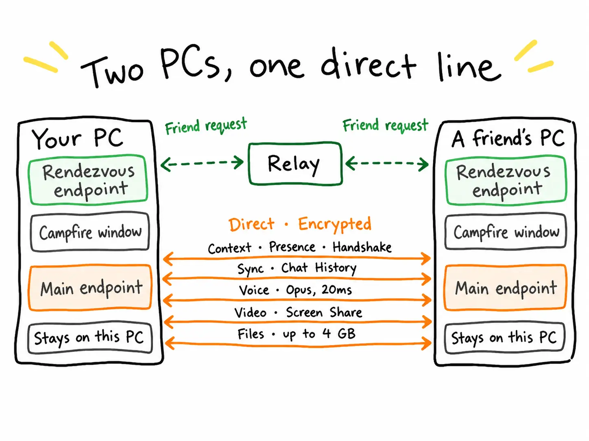

<div align="center">

# 🔥 Campfire

**Voice, screen sharing and chat for groups of friends, with no server in between.**

[](https://github.com/TobiasStark/campfire/releases)
[](#license)


[Download](https://github.com/TobiasStark/campfire/releases) · [Installation](docs/installation.md) · [Protocol](docs/protocol.md) · [Building](docs/building.md) · [Changelog](CHANGELOG.md)

<br>



</div>

<br>

Campfire is fully peer-to-peer: no server of its own, no cloud, no account with any provider. Messages, files and streams travel directly between your friends' devices, and your data stays on your PC.

## Features

- 🎙️ **Voice channels** with Opus, push-to-talk (global hotkey, mouse buttons included) and an in-game overlay
- 🖥️ **Screen streaming** in voice channels with hardware encoding (NVENC / AMF / QSV), game audio (Windows 11) and two quality tiers
- 💬 **Text chat** in spaces and direct messages: basic Markdown, replies, editing, mentions and unread counters
- 📁 **File sharing** up to 4 GB, directly between members, with previews and resumable downloads
- 👥 **Friends** via friend code, presence (online, away, do not disturb) and blocking
- 🔐 **Backup** of your account as a password-protected file; keys are stored locally, protected by DPAPI
- 🎨 Light and dark theme, every color customizable
- 🌍 English by default, German selectable in the settings
- 🔄 Updates via Velopack, only after your confirmation

## How it works

Every connection is made directly between two PCs and is encrypted. The only thing that touches the network infrastructure is the first handshake: a friend request is passed through a relay to a dedicated rendezvous endpoint. After that, everything runs over the main endpoint:

| Traffic | Path |
|---|---|
| Context, presence, handshake | Direct, encrypted |
| Sync and chat history | Direct, encrypted |
| Voice (Opus, 20 ms frames) | Direct, encrypted |
| Video and screen share | Direct, encrypted |
| Files up to 4 GB | Direct, encrypted |

If a direct connection is not possible, for example behind a strict NAT, iroh falls back to a relay. Traffic stays end-to-end encrypted either way. The wire format is documented in [docs/protocol.md](docs/protocol.md).

## Installation

1. Download `Campfire-win-Setup.exe` from the [Releases](https://github.com/TobiasStark/campfire/releases) page.
2. Run the installer. Windows SmartScreen may show a warning, see [docs/installation.md](docs/installation.md) for details.
3. Share your friend code with a friend and start talking.

Requires Windows 10 or later. Game audio capture for streams requires Windows 11.

## Technology

Rust, [iroh](https://github.com/n0-computer/iroh) (QUIC, hole punching, relay fallback), [iced](https://github.com/iced-rs/iced) for the UI, SQLite for local storage, ffmpeg (LGPL) for video.

| Directory | Contents |
|---|---|
| `apps/desktop` | The Windows app (`campfire.exe`) |
| `apps/node` | Placeholder for a future headless node |
| `crates/app-proto` | Wire protocol (see [docs/protocol.md](docs/protocol.md)) |
| `crates/app-net` | Networking on iroh |
| `crates/app-core` | Identity, friends, presence, event log, storage |
| `crates/app-audio` | Voice: capture, playback, Opus, jitter buffer |
| `crates/app-video` | Capture, encoding, decoding |
| `crates/app-blobs` | File storage and transfer (iroh-blobs) |
| `crates/app-hotkeys` | Global hotkeys / push-to-talk |
| `crates/app-testkit` | Helpers for network tests |
| `tools/nettest` | Connectivity test between two machines |

## Building

```sh
cargo build --release -p app-desktop --bin campfire
```

Prerequisites, ffmpeg setup and packaging: [docs/building.md](docs/building.md).

## Contributing

Issues and pull requests are welcome. Please run `cargo fmt` and `cargo clippy` before submitting, and see [CHANGELOG.md](CHANGELOG.md) for recent changes.

## License

Licensed under either of the following, at your option:

- Apache License, Version 2.0 ([LICENSE-APACHE](LICENSE-APACHE))
- MIT license ([LICENSE-MIT](LICENSE-MIT))

Unless you explicitly state otherwise, any contribution you submit for inclusion in this project is licensed under the same dual license.

The installer includes ffmpeg libraries under the LGPL, see [packaging/THIRD-PARTY-NOTICES.txt](packaging/THIRD-PARTY-NOTICES.txt).
